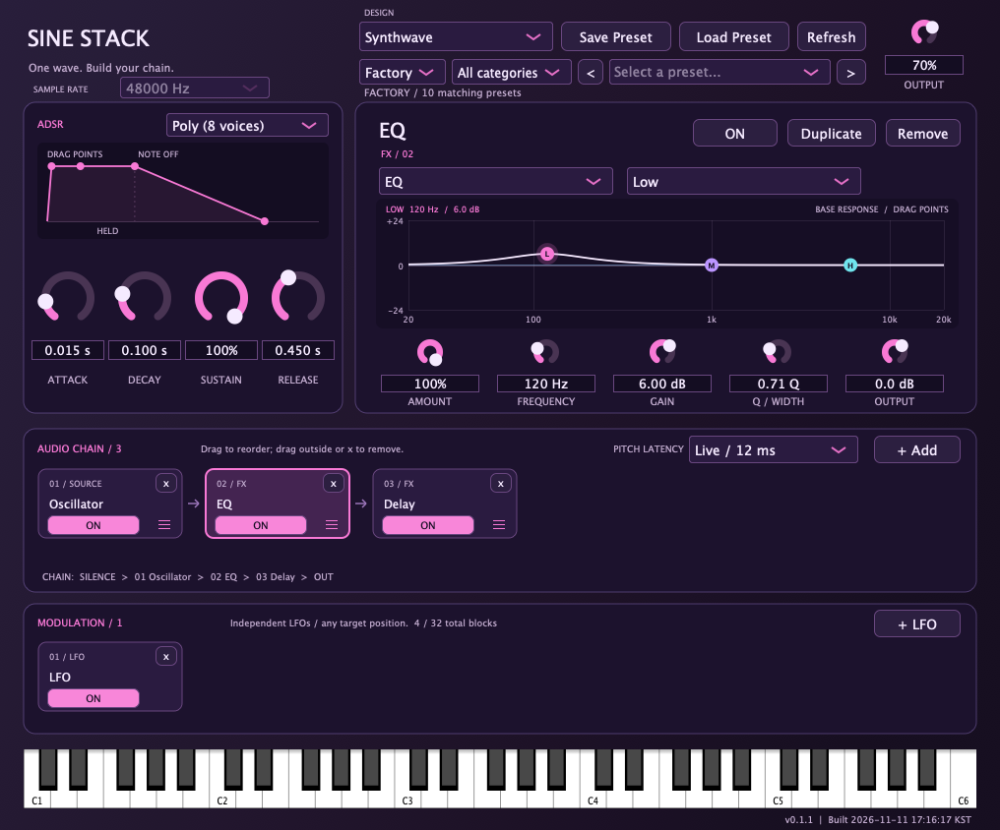

# Sine Stack

**One wave. Build your chain.**

단순한 파형에서 시작해 기타 이펙터처럼 효과를 하나씩 쌓는 신디사이저입니다. 소스와 오디오 효과를 드래그해 신호 흐름을 만들고, 독립적인 LFO로 여러 파라미터를 움직일 수 있습니다.

**macOS 11+ · Universal (Apple Silicon / Intel) · AU / VST3 / Standalone**

[설치 안내](docs/installation.md) · [사용 설명서](docs/user-guide.md) · [개발·빌드](docs/development.md) · [버전·배포](docs/releases.md) · [변경 이력](CHANGELOG.md)



## 설치

[GitHub Releases](https://github.com/choi00608/Sine-Stack/releases)에 설치 파일이 게시된 뒤 아래 명령으로 **AU·VST3·Sine Stack.app을 한 번에 설치하거나 업데이트**합니다. Python·Homebrew·빌드 도구나 `sudo`는 필요하지 않습니다.

```sh
curl -fL --proto '=https' --proto-redir '=https' \
  https://github.com/choi00608/Sine-Stack/releases/latest/download/install.sh -o install.sh && bash install.sh
```

다음 업데이트부터는 저장된 도구를 실행합니다.

```sh
bash "$HOME/Library/Application Support/SineStack/Installer/install.sh"
```

릴리스 게시 전이거나 오프라인이라면 같은 버전의 `install.sh`, `SineStack-0.1.3-macOS-Universal.tar.gz`, `SHA256SUMS.txt`를 한 폴더에 놓고 실행합니다.

```sh
bash install.sh --archive "SineStack-0.1.3-macOS-Universal.tar.gz"
```

파일을 더블클릭해 설치하려면 Releases의 `.pkg`를 사용하세요. **AU·VST3·실행 앱 모두 기본 선택**되며 관리자 인증 후 시스템 전체에 설치됩니다. GitHub의 `Source code (zip)`은 설치 파일이 아닙니다.

| 형식 | 터미널 설치 위치 | `.pkg` 설치 위치 |
|---|---|---|
| AU | `~/Library/Audio/Plug-Ins/Components/` | `/Library/Audio/Plug-Ins/Components/` |
| VST3 | `~/Library/Audio/Plug-Ins/VST3/` | `/Library/Audio/Plug-Ins/VST3/` |
| 실행 앱 | `~/Applications/Sine Stack.app` | `/Applications/Sine Stack.app` |

설치 후 앱과 DAW를 완전히 종료했다가 다시 열어 주세요. 사용자 프리셋과 설정은 유지됩니다. 현재 산출물은 macOS용이며 Windows·Linux·AAX 배포물은 제공하지 않습니다.

현재 패키지는 Developer ID 서명·Apple 공증이 없고 번들은 ad-hoc 서명입니다. 설치 차단, DAW 재검색, 설치 위치를 바꿀 때의 구버전 정리는 [설치 안내](docs/installation.md)를 참고하세요.

## 주요 기능

| 영역 | 기능 |
|---|---|
| 소스 | Sine / Square / Saw 오실레이터, 서브 오실레이터, 노이즈, 튜닝·팬·레벨 |
| 연주 | 8음 Poly, Mono Retrigger, Mono Legato, MIDI velocity·피치 벤드, 화면 건반 |
| 엔벌로프 | 전체 ADSR, 노브와 동기화되는 그래프, 제어점 드래그 편집 |
| 오디오 체인 | 실제 배치 순서에 따른 처리, 횡스크롤, 중복 추가·복제·바이패스·드래그 재배치·삭제 |
| 피치 효과 | Unison / Detune, Harmonizer, Glide, Live / Detail 지연 모드 |
| 오디오 FX | Drive, Chorus, Delay, Reverb, Filter, Tremolo, Phaser, 3밴드 EQ |
| 모듈레이션 | 체인과 분리된 LFO, LFO 하나당 최대 8개 연결, 대상별 깊이, 블록 위치와 무관한 연결 |
| 템포 | LFO·Delay의 DAW 템포 동기화, 1/1~1/64, 점음표·셋잇단음표 |
| EQ | 주파수 응답 그래프, 밴드별 Frequency·Gain·Q, 점 드래그와 노브 연동 |
| 프리셋 | 내장 사운드 10개, Factory / User, 카테고리 필터, 이전·다음, 카테고리 지정 저장 |
| 디자인 | Synthwave, Classic Green 등 7개 테마, 사운드와 독립적인 테마 설정 |

AUDIO CHAIN과 MODULATION을 합쳐 최대 **32개 블록**을 지원합니다. 프리셋과 DAW 상태에는 블록 구성·설정·연결을 저장합니다. 사용자 프리셋은 `.sinestack` 확장자의 읽을 수 있는 JSON 파일입니다.

## 빠르게 사용하기

1. **Factory** 뱅크에서 프리셋을 선택하고 MIDI 건반이나 화면 건반으로 연주합니다. **All categories**에서 Bass·Lead·Pad 등을 골라 볼 수 있습니다.
2. 왼쪽 **ADSR** 노브 또는 그래프의 점을 움직여 음의 시작과 끝을 조절합니다.
3. 아래 **AUDIO CHAIN → + Add**로 소스나 FX를 추가합니다. 블록을 클릭하면 오른쪽에 세부 설정이 나타납니다.
4. 블록을 드래그해 순서를 바꾸고, **ON / BYPASSED**로 비교합니다. **Duplicate**는 설정을 복제하며, **x**는 블록을 삭제합니다.
5. **MODULATION → + LFO**에서 대상을 연결합니다. **+ Target**으로 연결을 추가하고 각 **Depth**를 조절합니다.
6. **Save Preset → Category → Continue**에서 카테고리를 고른 뒤 파일을 저장합니다.

처음에는 `Oscillator → Drive → Filter → Delay → Reverb`처럼 만들어 보세요. 오디오 블록은 왼쪽에서 오른쪽으로 처리되며, 뒤에서 추가한 소스에는 앞쪽 FX가 적용되지 않습니다. 새 LFO는 대상을 지정해야 소리에 영향을 줍니다.

자세한 조작과 동기화·레가토·지연 설명은 [사용 설명서](docs/user-guide.md), 기본 음색 소개는 [Factory Presets](Factory%20Presets/README.md)에 있습니다.

## 버전 정보

현재 문서 기준 버전은 **0.1.3**입니다. 최신 기준값은 루트 [version.json](version.json), 변경 내역은 [CHANGELOG.md](CHANGELOG.md)에서 확인합니다.

- 앱과 플러그인의 **건반 아래 오른쪽**에 현재 실행 중인 버전과 빌드 날짜·시각이 표시됩니다.
- AU·VST3·Standalone은 공통 버전과 빌드 시각을 사용합니다.
- 소스·빌드 정의·배포 도구가 바뀌면 다음 빌드 준비에서 패치 번호가 자동 증가합니다.
- 변경 없는 재빌드·재설치·동일 소스의 실패 후 재시도에는 버전이 추가로 올라가지 않습니다.
- 업데이트 후 실행 중이던 앱과 DAW를 완전히 종료했다가 다시 열어야 새 빌드를 사용합니다.

## 저장소와 문서

```text
README.md                  프로젝트 소개와 빠른 시작
CHANGELOG.md               버전별 변경 이력
CONTRIBUTING.md            수정·검증·문제 보고 안내
docs/                      설치·사용·개발·배포 문서와 화면 이미지
sine stack au/             AU + Standalone 소스와 테스트
sine stack vst3/           VST3 + Standalone 소스와 테스트
Factory Presets/           내장 프리셋 파일 사본과 오디오 예시
assets/                    실행 앱 아이콘 원본
cmake/                     공통 버전 구성
scripts/                   버전 관리·통합 빌드 및 설치·검사
packaging/                 터미널 설치·업데이트 및 macOS 패키지 생성·검증
version.json               공통 버전·빌드 시각·소스 식별 정보
dist/                      생성된 배포 파일 (Git 제외)
```

전체 문서 목록은 [docs/README.md](docs/README.md)에 있습니다. 소스와 문서는 저장소에서, 설치 파일은 GitHub Releases에서 관리하는 구성을 사용합니다. AU·VST3는 소스 복사본이 별도로 있으므로 공통 기능 수정 시 양쪽을 함께 반영합니다.

## 의존성과 라이선스

Sine Stack의 자체 코드와 관련 문서는 [MIT License](LICENSE)로 제공합니다. 저작권 표기는 `Copyright (c) 2026 choi00608`이며, 복사·수정·재배포 시 라이선스의 저작권 및 허가 고지를 유지해야 합니다.

JUCE 8.0.12, Signalsmith Stretch 1.3.2, Signalsmith Linear 0.6.6 등 외부 코드는 각 원래 라이선스를 따릅니다. 특히 JUCE가 포함된 AU·VST3·실행 앱의 배포에는 JUCE의 AGPLv3 또는 상용 라이선스 조건도 적용되며, 이 프로젝트의 MIT 라이선스가 이를 대체하지 않습니다. 출처와 적용 범위는 [의존성과 라이선스 안내](docs/reference/dependencies.md)를 참고하세요.
